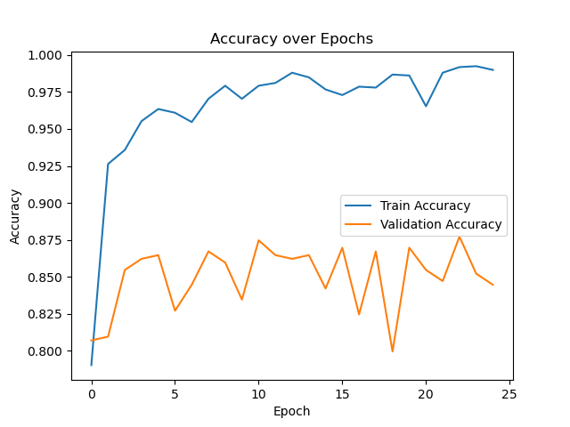
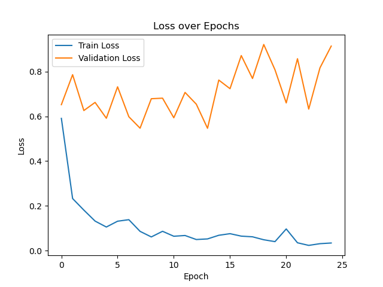
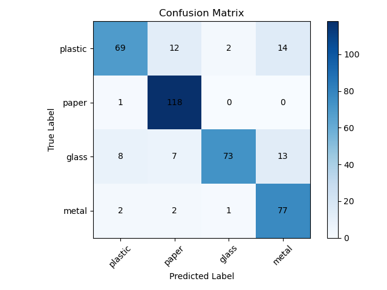

# Smart Waste Segregation System (HPC & Deep Learning)

An end-to-end, GPU-accelerated computer vision and full-stack web platform for automated municipal waste classification (**Plastic, Paper, Glass, Metal**). Engineered on the **Ramanujan Universe Supercomputer** using **PyTorch, CUDA, and OpenMP**, and deployed with a **React.js (Vite), Node.js/Express, and MongoDB** web architecture.

---

## Key Engineering Highlights

* **High-Performance Computing (HPC) Pipeline:** Orchestrated training jobs via PBS Scheduler (`ml/job_train.pbs`) on an **NVIDIA A100 GPU**, utilizing multi-threaded **OpenMP** preprocessing across 96 CPU threads (`ml/preprocess.py`) for an **18.5x speedup** to eliminate I/O bottlenecks.
* **Bias & Overfitting Mitigation:** Addressed severe TrashNet class imbalance across a 2,000-image subset using geometric data augmentation (`ml/augment.py`), class-weighted cross-entropy loss, L2 weight decay (`1e-4`), and macro-averaged recall checkpointing—shrinking the train-validation accuracy gap from **26% to 9%** (**66.4% validation accuracy**).
* **Full-Stack Real-Time Inference:** Built a decoupled **React.js + Vite** frontend and **Node.js/Express** backend connected to **MongoDB** (`backend/models/Scan.js`), spawning a child-process Python inference bridge (`ml/predict.py`) for real-time webcam classification and persistent scan analytics.

---

## System Architecture

    SmartWasteSegregation/
    ├── ml/                         # HPC & Deep Learning Pipeline
    │   ├── config.py               # Hyperparameters, paths, and device configurations
    │   ├── preprocess.py           # OpenMP multi-threaded image preprocessing
    │   ├── augment.py              # Geometric & color-jitter data augmentation
    │   ├── dataset.py              # Custom PyTorch Dataset & DataLoader definitions
    │   ├── model.py                # 3-Layer Convolutional Neural Network (CNN) architecture
    │   ├── train.py                # Training loop with macro-recall checkpointing
    │   ├── predict.py              # Inference script bridged with Node.js backend
    │   ├── job_train.pbs           # PBS cluster submission script (Ramanujan Supercomputer)
    │   └── results/                # Training curves & evaluation confusion matrix
    ├── backend/                    # Node.js, Express & MongoDB REST API
    │   ├── config/db.js            # MongoDB connection setup
    │   ├── controllers/            # Prediction child-process bridge & scan history logic
    │   ├── models/Scan.js          # Mongoose schema for persistent waste scan analytics
    │   ├── routes/                 # Express routes (/api/predict, /api/history)
    │   └── server.js               # Backend entry point
    └── frontend/                   # React.js (Vite) Client Application
        ├── src/components/         # Webcam capture & real-time classification UI
        ├── src/pages/              # Dashboard & historical analytics views
        └── src/api/                # API client hooks

---

## Model Evaluation & Training Telemetry

| Training & Validation Accuracy | Training & Validation Loss |
| :---: | :---: |
|  |  |

### Confusion Matrix

---

## Local Setup & Installation

### 1. Machine Learning Environment

    cd ml
    pip install -r requirements.txt
    bash run_train.sh

### 2. Backend Server (Node.js & MongoDB)

    cd backend
    npm install
    npm start

### 3. Frontend Client (React + Vite)

    cd frontend
    npm install
    npm run dev
